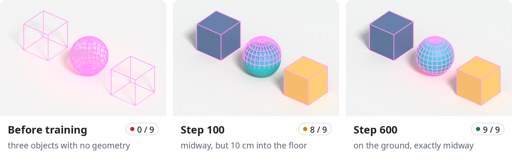
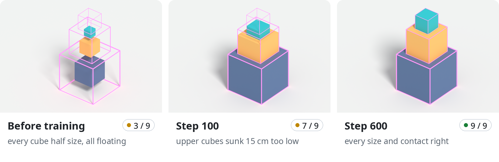
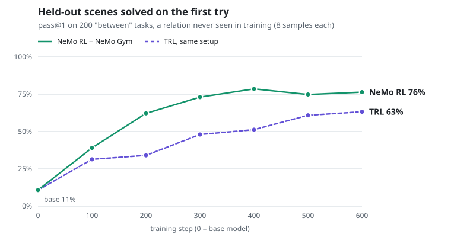
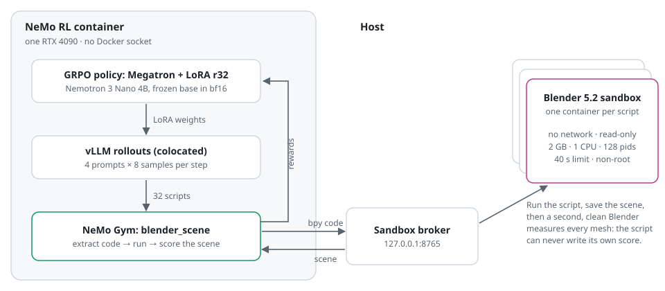

# nemotron-4b-blender-lora

<p align="center">
  
</p>
<p align="center"><sub>Pink wireframes: where the checker wants each object. Solid: what the model's script built. The task, a sphere exactly halfway between two cubes, never appears in training.</sub></p>

Teaching a 4B model to build 3D scenes in Blender, using reinforcement learning on a single RTX 4090. NVIDIA's Nemotron 3 Nano 4B reads a scene described in plain English and writes a Blender Python (`bpy`) script to build it. The script runs in a locked-down Blender, and the reward comes from measuring the scene it actually built, not from another model's opinion. Training is GRPO with a LoRA adapter, on NVIDIA's own RL stack: [NeMo RL](https://github.com/NVIDIA-NeMo/RL) for the trainer and [NeMo Gym](https://github.com/NVIDIA-NeMo/Gym) for the environment.

- **Verifiable reward.** Every reply is executed. A second, clean Blender then measures each mesh (size, position, contact with the ground and with its neighbours) against the task's geometric checks, to 3 cm.
- **A held-out relation.** Training covers two relations, *stack on top of* and *place next to*. Evaluation adds a third the model never trains on, *exactly halfway between*. That tests whether it learned spatial reasoning in `bpy` or just memorised two templates.
- **One consumer GPU.** Policy, vLLM rollouts and the Gym environment share 24 GiB. A 600-step run takes 3.5 hours.
- **A sandbox, not trust.** Model-written code runs in throwaway containers with no network and a read-only filesystem. The training container never gets the Docker socket.

> **Status:** a research experiment, not a library. Results so far come from one training seed; a second seed is running now.

## Results

| | Base model | After 600 steps |
| --- | --- | --- |
| Trained relations (stack, next to): solved first try | 1.8% | **99.8%** |
| Held-out relation (between): solved first try | 10.8% | **76.4%** |
| Held-out: scripts that crash | 36% | **0.5%** |

Each number is 200 tasks with 8 samples per task. On the held-out relation, the trained model's single try (76.4%) beats the base model's best of eight (54.5%).

<p align="center">
  
</p>
<p align="center"><sub>A trained relation: stack three cubes, each centred on the one below.</sub></p>

<picture>
  <source media="(prefers-color-scheme: dark)" srcset="docs/images/heldout-dark.svg">
  
</picture>

The same experiment run with Hugging Face TRL (same tasks, seed, LoRA rank, learning rate, rollout count and eval harness) reached 63.2%. NeMo RL's lead at step 600 is +13.1 points (95% CI +10.0 to +16.4, paired over tasks). Why it wins is still open: matching the two most obvious differences made TRL train faster but generalise *worse*. [docs/RESULTS.md](docs/RESULTS.md) has the numbers, the hypotheses and the ablation that ruled one out.

What's left on the held-out relation is almost one mistake: 360 of the 370 wrong scenes fail only the *resting on the ground* check. The middle object is in the right place and the right size, at the wrong height. Cubes and spheres make it about equally often.

The full run report, with per-checkpoint evals, error mix and the top-scoring samples to read for reward hacking, is in [results/nemotron4b](results/nemotron4b/report.md).

## Quick start

You need Linux, an NVIDIA GPU with 24 GiB, Docker with the [NVIDIA Container Toolkit](https://docs.nvidia.com/datacenter/cloud-native/container-toolkit/) set up for CDI (`--device nvidia.com/gpu=all`), [uv](https://docs.astral.sh/uv/), and about 120 GiB of free disk (the NeMo RL image alone is 74 GB).

**1. Get the code and the host environment.** vLLM evaluation, the sandbox broker and the report run on the host:

```sh
git clone https://github.com/quinnovator/nemotron-4b-blender-lora && cd nemotron-4b-blender-lora
uv sync
```

**2. Build the sandbox and pull the trainer.**

```sh
docker build -t blender-sandbox sandbox/       # Blender 5.2.2 LTS on Ubuntu 24.04
docker pull nvcr.io/nvidia/nemo-rl:v0.7.0       # NeMo RL with NeMo Gym v0.4.0 bundled
```

**3. Check it before spending GPU hours.**

```sh
.venv/bin/python orchestrate.py configs/nemotron4b.yaml --until gate
```

This probes the sandbox, samples the tasks, evaluates the base model and stops at the gate. It takes about 25 minutes, plus the model download the first time. `runs/nemotron4b/preflight.md` should be all PASS and `gate.md` should say PROCEED.

**4. Train and evaluate.**

```sh
./run.sh configs/nemotron4b.yaml               # in tmux as brl-nemotron4b; retries crashes
tail -f runs/nemotron4b/orchestrate.log
```

About 3.5 hours of GRPO, then about 2 hours of vLLM evals on every 100th checkpoint. The run ends with `runs/nemotron4b/report.md`. Every stage leaves a `.done_*` marker, so a rerun picks up where it stopped.

## How it works

<picture>
  <source media="(prefers-color-scheme: dark)" srcset="docs/images/architecture-dark.svg">
  
</picture>

A task is a template and its sampled parameters, for example:

> Create a cube named "Post" with edge length 0.53 m resting on the ground, centred at x = 1.40, y = 2.50, and a cube named "Box" with edge length 0.80 m resting on the ground, centred at x = 3.34, y = 5.46. Then place a UV sphere named "Plinth" with radius 0.41 m resting on the ground, exactly halfway between "Post" and "Box".

Each step, vLLM samples 8 scripts for each of 4 tasks. NeMo Gym's `blender_scene` resources server pulls the code out of each reply and sends it to the sandbox broker. The broker runs it in two phases: the script runs and the scene is saved, then a fresh Blender that only runs trusted code reads the saved scene and measures it. A script that exits early or writes its own measurements gets nothing. The score is

```
reward = 0.1 if it runs  +  0.5 × share of checks passed  +  0.4 if every check passes
```

GRPO compares the 8 scores for each task, and the LoRA adapter (rank 32, on attention and Mamba `in_proj`) moves toward the better scripts. After training, each Megatron checkpoint is exported as a PEFT adapter, and vLLM on the host evaluates it on 200 tasks of each relation.

The pipeline is seven stages in [orchestrate.py](orchestrate.py):

| Stage | What it does |
| --- | --- |
| `preflight` | Proves the sandbox holds: infinite loop, network access, writes outside the job, a forged measurement file and a fork bomb must all fail |
| `build_tasks` | Samples 2,000 training tasks and 200 + 200 eval tasks from seed 7, and asserts no eval task leaked into training |
| `baseline` | Evaluates the base model, 8 samples per task |
| `gate` | Stops unless the base model's mean reward is between 0.15 and 0.85 and at least 40% of tasks get varied scores; otherwise GRPO has nothing to learn from |
| `train` | GRPO in the NeMo RL container, a checkpoint every 50 steps, then exports them as PEFT adapters |
| `eval_ckpts` | Evaluates every 100th checkpoint on both splits |
| `report` | Learning curves with bootstrap CIs, error mix, and the top-scoring samples to read for reward hacking |

## Fitting it on one 4090

NeMo RL is built for clusters. Running the policy, vLLM and the environment on one 24 GiB card took a handful of settings, each explained where it's set in [configs/nemo/grpo_nemotron4b.yaml](configs/nemo/grpo_nemotron4b.yaml) and [nemo/docker_run.sh](nemo/docker_run.sh):

- **Megatron, not DTensor.** The DTensor path keeps every parameter in fp32 for FSDP, frozen base included: about 15 GiB for 4B. Megatron keeps the base in bf16, and only the LoRA weights get fp32 master copies.
- **Smaller NCCL buffers.** Megatron opens about nine single-rank process groups, at about 0.38 GiB of buffers each. On one GPU nothing is ever sent, so they're shrunk to about 0.01 GiB.
- **A fixed weight-refit buffer.** The default (30% of free memory) is smaller than the 822 MB embedding matrix once vLLM and the policy share the card.
- **Activation checkpointing off.** Megatron's full-layer recompute is reentrant. With a frozen embedding, the checkpointed blocks' inputs don't require grad, so the LoRA weights got no gradient at all (grad norm 0.0 in the pilot).
- **vLLM sized for Mamba.** 42% of the card, a float32 Mamba state cache, and 64 sequence slots so each of the 32 rollouts per step gets its own cache block.

Peak whole-card memory during training was 22.4 GiB (desktop included), and a median step took 20 seconds.

## Repository layout

| Path | What's there |
| --- | --- |
| [configs/](configs) | Run configs: [nemotron4b.yaml](configs/nemotron4b.yaml) (the main run), [nemotron4b-seed8.yaml](configs/nemotron4b-seed8.yaml) (second seed), and the NeMo RL GRPO config |
| [envlib/](envlib) | Task templates and checks, reward, sandbox runner, vLLM evaluation |
| [gym_env/blender_scene/](gym_env/blender_scene) | The NeMo Gym resources server, its config and tests ([README](gym_env/blender_scene/README.md)) |
| [sandbox/](sandbox) | The Blender sandbox image, the two-phase job script, the host-side broker and the render pass |
| [nemo/docker_run.sh](nemo/docker_run.sh) | Runs a command in the NeMo RL container with the right mounts and NCCL settings |
| [stages/](stages) | The seven pipeline stages |
| [results/](results) | The main run's evals, training log and report; TRL comparison numbers |
| [tools/](tools) | Scene renders for write-ups ([render_examples.py](tools/render_examples.py), laid out as captioned strips by [strip.py](tools/strip.py)) and the README charts ([figures.py](tools/figures.py)) |
| [tests/](tests) | Oracle solutions pass every check, broken ones don't (`.venv/bin/python tests/test_env.py docker`) |

## Security

- **Model-written code only runs in the sandbox.** Each script gets its own container: no network, read-only root, 2 GB of memory, 1 CPU, 128 processes, a non-root user, all capabilities dropped and a 40-second limit. `preflight` checks this before every run.
- **Measurement is separate from execution.** A second Blender, running only trusted code, reads the saved scene, so nothing the script does can forge its own score.
- **The training container has no Docker socket.** NeMo Gym reaches the sandbox only through the broker, which listens on `127.0.0.1` and runs nothing but the sandbox image.
- **Reward hacking is reviewed, not assumed away.** The report collects the 20 top-scoring samples and flags any that match a watchlist of hack patterns (file access, early exits, subprocesses, sockets). None of the main run's top 20 matched.

## License

This project is licensed under the [Apache License 2.0](LICENSE).

It builds on third-party components under their own licenses:

| Component | Used for | License |
| --- | --- | --- |
| [NVIDIA Nemotron 3 Nano 4B](https://huggingface.co/nvidia/NVIDIA-Nemotron-3-Nano-4B-BF16) | The policy | [NVIDIA Nemotron Open Model License](https://www.nvidia.com/en-us/agreements/enterprise-software/nvidia-nemotron-open-model-license/) |
| [NeMo RL](https://github.com/NVIDIA-NeMo/RL) 0.7.0 (container) | GRPO training | Apache-2.0 |
| [NeMo Gym](https://github.com/NVIDIA-NeMo/Gym) 0.4.0 | The environment | Apache-2.0 |
| [vLLM](https://github.com/vllm-project/vllm) 0.31.0 | Evaluation | Apache-2.0 |
| [Blender](https://www.blender.org) 5.2.2 LTS | Running and measuring scenes, in the sandbox image | GNU GPL |

Adapters trained here are derived from Nemotron and carry its license.
