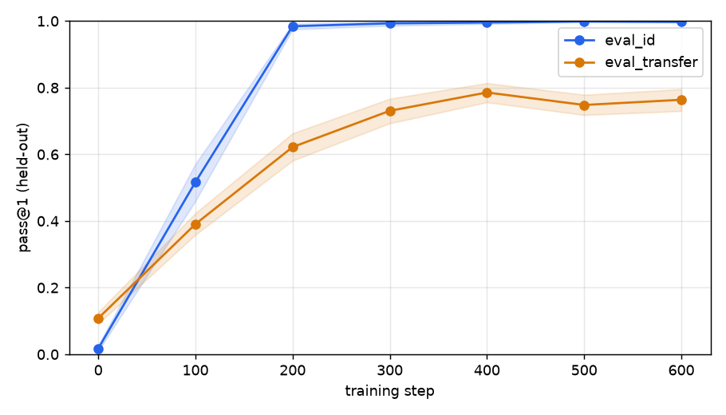
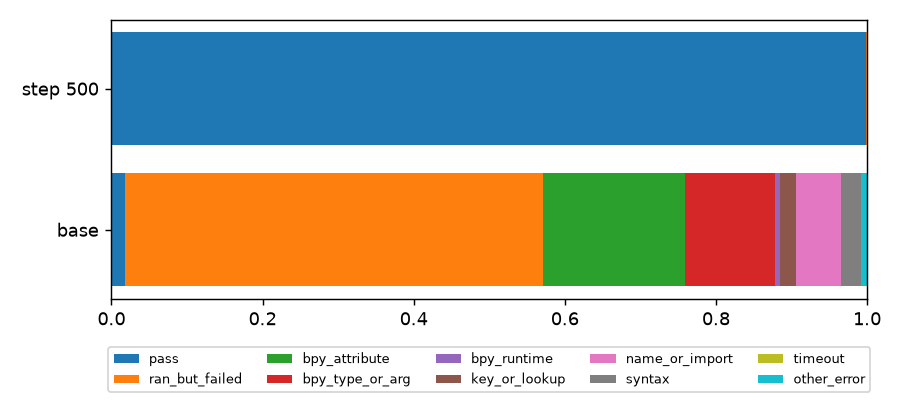
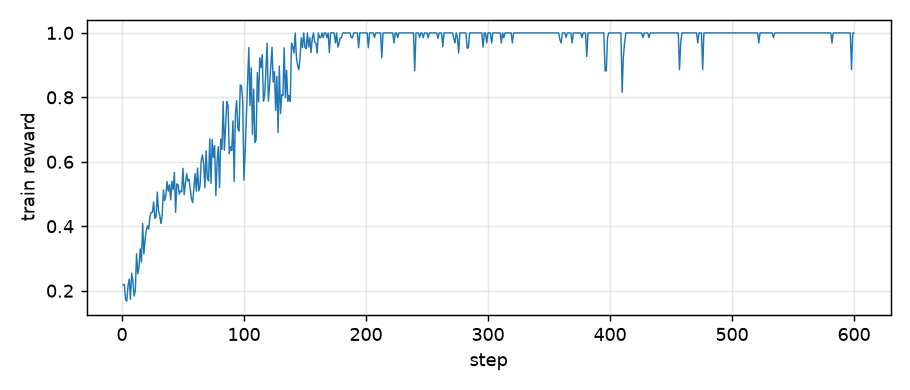

# Run report: nemotron4b

Model: `nvidia/NVIDIA-Nemotron-3-Nano-4B-BF16`

## Gate

```
mean_reward=0.214  signal_fraction=0.99  pass@1=0.018  pass@n=0.105
band: 0.15 <= mean_reward <= 0.85, signal_fraction >= 0.4
decision=PROCEED
If too low: make tasks easier or add a short SFT warm start. If too high: add harder templates.
```

## 1. Did held-out pass@1 go up?

| split | base pass@1 | best step | best pass@1 | gain (95% CI over tasks) | verdict |
|---|---|---|---|---|---|
| eval_id | 0.018 | 500 | 0.999 | +0.981 [+0.973, +0.989] | PASS |
| eval_transfer | 0.108 | 400 | 0.786 | +0.677 [+0.647, +0.708] | PASS |



The best step is picked per split on that split's own curve, so treat the gain as slightly optimistic; the final checkpoint is in the curve.

## 2. Did the error mix change?

- **base** (eval_id): ran_but_failed 55%, bpy_attribute 19%, bpy_type_or_arg 12%, name_or_import 6%, syntax 3%, key_or_lookup 2%, pass 2%, other_error 1%, bpy_runtime 1%
- **step 500** (eval_id): pass 100%, ran_but_failed 0%, bpy_attribute 0%



## 3. Does trained pass@1 beat base pass@8?

| split | base pass@1 | base pass@8 | trained pass@1 (best) | trained pass@1 (final) | beats base pass@8? |
|---|---|---|---|---|---|
| eval_id | 0.018 | 0.105 | 0.999 | 0.998 | yes (final) |
| eval_transfer | 0.108 | 0.545 | 0.786 | 0.764 | yes (final) |

## 4. Do top-reward samples look like real solutions?

Top 20 eval_id samples at step 500: 0 match the hack watchlist regex (manual read still required). Full texts in `report_top20.md`.

## 5. Architecture panel

- Peak device memory used during training (whole card): 22.4 GiB
- Median step time: 20.1 s over 600 steps
- Rollout throughput at baseline (vLLM, n=8): 2967 tokens/s



